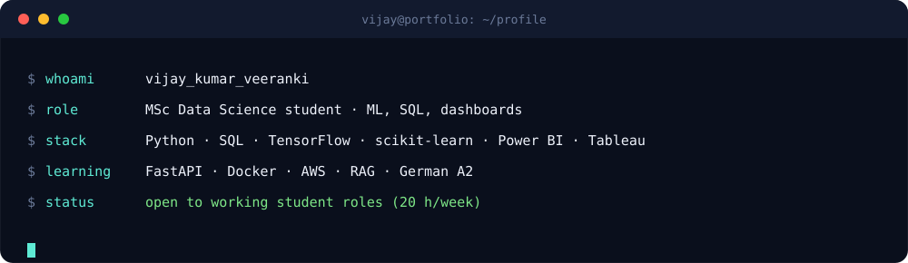

<b>Machine learning · SQL · dashboards</b> Master's student in Germany. I build, measure honestly and explain the result.

---

<h2 align="center">Tech stack</h2>

---

<h2 align="center">Featured projects</h2>

Click a card to open the code or the live demo. All 15 projects: <a href="https://veerankyvijay.github.io/personal-portfolio/#projects">portfolio</a>

<table>
<tr>
<td width="50%" valign="top" align="center">
 
<b>Brain tumour detection</b> TensorFlow CNN that classifies brain scans, built at ICMR-NIRT with a Tkinter GUI for real-time testing. <code>TensorFlow · CNN · Tkinter</code> 
</td>
<td width="50%" valign="top" align="center">
 
<b>Flight booking prediction</b> Random Forest on British Airways data to predict whether a customer completes a holiday booking. <code>Python · Random Forest · scikit-learn</code> 
</td>
</tr>
<tr>
<td width="50%" valign="top" align="center">
 
<b>Superstore sales dashboard</b> Interactive dashboard on 8,399 orders from my Tableau course: filters, KPIs, trend, profit by sub-category and computed insights. <code>Tableau · Python · JavaScript</code>  
</td>
<td width="50%" valign="top" align="center">
 
<b>SQL analytics</b> Ten verified PostgreSQL queries on the Chinook database: joins, window functions and CTEs. <code>PostgreSQL 17 · JOIN · Window functions</code> 
</td>
</tr>
<tr>
<td width="50%" valign="top" align="center">
 
<b>Coffee sales analysis and forecast</b> Cleaning, feature building and a 1, 7 and 30 day Holt-Winters forecast. <code>Python · Time series · Jupyter</code> 
</td>
<td width="50%" valign="top" align="center">
 
<b>End-to-end risk predictor (in progress)</b> Imbalanced-class prediction from raw data to a FastAPI service in Docker with a dashboard. <code>FastAPI · Docker · scikit-learn</code> 
</td>
</tr>
</table>

---

<h2 align="center">Experience and education</h2>

| When | Role |
|---|---|
| Oct 2026 – now | M.Sc. Data Science, KU Eichstätt-Ingolstadt |
| Aug – Nov 2025 | Data Science Intern, Unified Mentor |
| Oct – Dec 2024 | Deep Learning Intern, ICMR-NIRT (brain-tumour CNN, 90%) |
| May – Jun 2024 | Power BI Intern, Codegnan (10,000+ records, automated refresh) |
| May – Jun 2024 | Machine Learning Intern, Codegnan (regression in R) |
| 2022 – 2025 | B.Sc. Data Science (Maths, Statistics & Data Science), P.B. Siddhartha College |

<h2 align="center">Certifications</h2>

AI Tools Workshop (2025) · Accelerating Deep Learning with GPUs, Cognitive Class (2025) · Deep Learning with TensorFlow, Cognitive Class (2025) · British Airways Data Science Job Simulation, Forage (2025) · Java, Great Learning (2024) · Power BI, BE10X (2024) · R for Data Science, Great Learning (2024) · SQL and RDBMS, Cognitive Class (2024)

---

<h2 align="center">Contact</h2>

 
Scan to open the portfolio

<b>Open to working student and internship roles in data analytics, machine learning and AI.</b>

Last updated 2026-11-11 · updated with every new project

